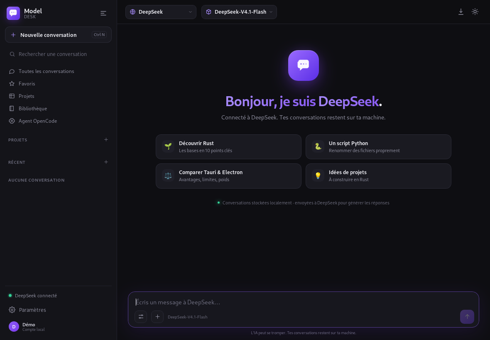
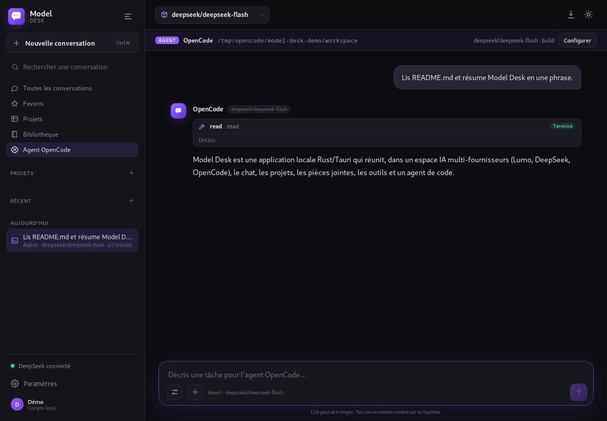
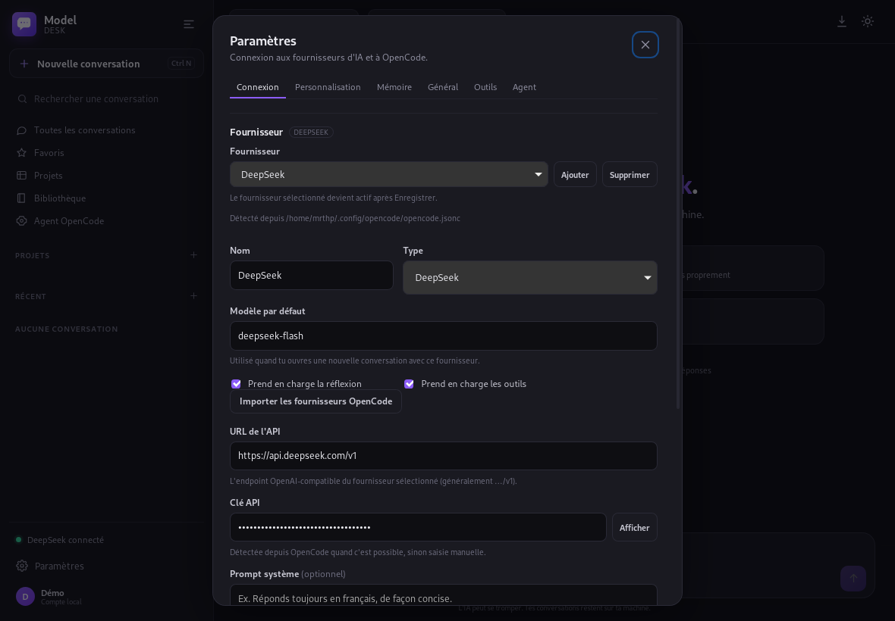
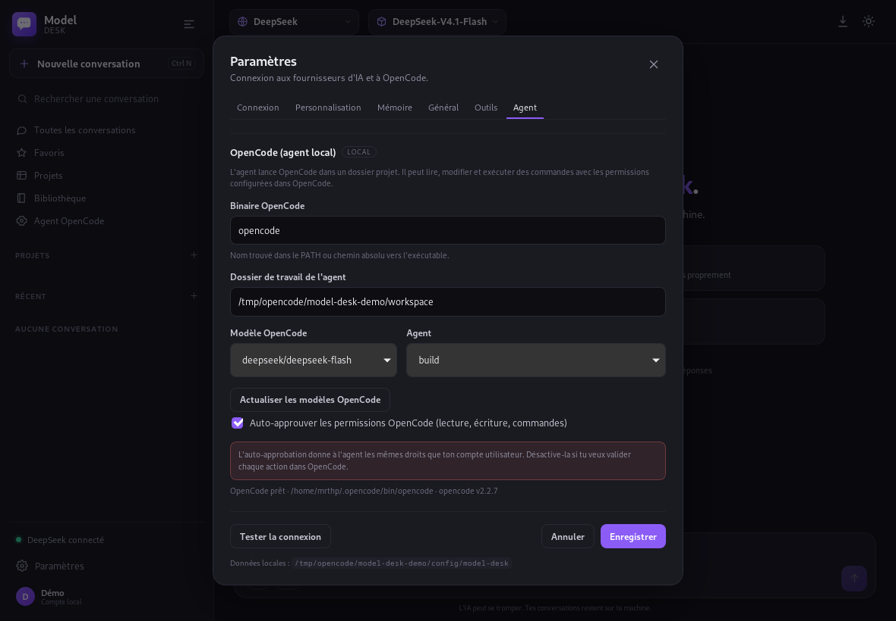

<div align="center">
  
  <h1>Model Desk</h1>
  <p><strong>Un espace IA local-first, multi-fournisseurs.</strong><br />
  <em>A local-first, multi-provider AI workspace.</em></p>
  <p>
    <a href="https://github.com/MrTHP/model-desk/releases/latest/download/Model-Desk_0.3.0_amd64.AppImage"></a>
    <a href="https://mrthp.github.io/model-desk/"></a>
    <a href="https://github.com/MrTHP/model-desk"></a>
  </p>
  <p>
    
    
    
    
  </p>
  <p><a href="#-français">🇫🇷 Français</a> · <a href="#-english">🇬🇧 English</a></p>
  <p><strong>Démo en ligne / Live demo :</strong> <a href="https://mrthp.github.io/model-desk/">mrthp.github.io/model-desk</a> · <strong>Releases :</strong> <a href="https://github.com/MrTHP/model-desk/releases">v0.3.0</a></p>
  
</div>

> **Unofficial project.** Model Desk is not affiliated with Proton AG. **Lumo** is a trademark of Proton AG. Model Desk talks to your own local [`lumo-tamer`](https://github.com/ZeroTricks/lumo-tamer) instance, which uses Proton Lumo's unofficial API.

---

## 🇫🇷 Français

**Model Desk** est un client de chat desktop multi-fournisseurs construit avec **Rust** et **Tauri v2**. Il se connecte à ton instance locale `lumo-tamer`, à l'**API DeepSeek**, ou à tout endpoint OpenAI-compatible, et peut aussi lancer l'**agent OpenCode** dans un dossier projet. L'interface transforme ces API en une vraie application de bureau : streaming, historique local, projets, mémoire, pièces jointes, outils fichiers et recherche web.

> **Projet non officiel.** Model Desk n'est pas affilié à Proton AG. **Lumo** est une marque de Proton AG.

L'interface suit la langue du système (français ou anglais), les conversations restent dans `~/.config/model-desk`, et l'application peut installer `lumo-tamer` puis ouvrir la fenêtre de connexion Proton pour toi.

### ✨ Fonctionnalités

- **Multi-fournisseurs** : Lumo Tamer, **DeepSeek** et tout endpoint OpenAI-compatible. La clé DeepSeek est détectée depuis OpenCode (`~/.local/share/opencode/auth.json`) ou saisie manuellement.
- **Agent OpenCode** : un mode agent qui lance `opencode run` dans un dossier projet, avec choix du modèle OpenCode, agent `build`/`plan`, auto-approbation optionnelle, streaming des réponses et des appels d'outils.
- **Streaming token par token** avec bouton Arrêter, affichage de la réflexion (`reasoning_content`) et rendu Markdown + coloration du code.
- **Historique local-first** : conversations, recherche, favoris, projets avec instructions et compteur de discussions.
- **Pièces jointes** : bouton « + », glisser-déposer, texte/code, PDF, DOCX/ODT, HTML, images. Extraction locale et **OCR** (`tesseract`), vignettes et aperçu.
- **Outils avec permissions** : lecture, écriture, recherche, commandes shell, sandbox de dossier et confirmations.
- **Personnalisation et mémoire** : nom, métier, contexte, consignes de comportement, souvenirs locaux et extraction automatique optionnelle.
- **Recherche web** native via `lumo-tamer`, en un clic.
- **Créations / Canvas** : les réponses HTML/SVG s'ouvrent dans un canvas sandboxé ; la bibliothèque garde les créations et images.
- **Barre système** : réduire dans le tray, rouvrir, nouvelle conversation ou quitter.
- **Installation tout-en-un** : Docker, Compose et git ; clone de `lumo-tamer`, configuration, navigateur Proton, authentification, démarrage et configuration du client.
- **FR / EN** selon la locale système, avec override dans les paramètres.

### 📸 Aperçu

| Chat multi-fournisseurs | Agent OpenCode |
| --- | --- |
|  |  |

| Réglages fournisseurs | Réglages agent |
| --- | --- |
|  |  |

### 🚀 Installation

Télécharge l'**AppImage** ou le paquet **.deb** depuis la page [Releases](https://github.com/MrTHP/model-desk/releases/latest).

```sh
chmod +x Model-Desk_0.3.0_amd64.AppImage
./Model-Desk_0.3.0_amd64.AppImage
```

Au premier lancement, si `lumo-tamer` n'est pas joignable, l'assistant propose de l'installer :

1. vérifie Docker, Docker Compose et git ;
2. clone `lumo-tamer` et génère les secrets + `config.yaml` ;
3. construit et démarre le navigateur d'authentification ;
4. ouvre `https://localhost:3001` pour la connexion Proton ;
5. exécute `tamer auth browser`, démarre le service et configure le client.

Si tu as déjà une instance `lumo-tamer`, renseigne simplement le dossier et la clé API dans **Paramètres → Connexion**. Les fournisseurs et la clé DeepSeek configurés dans OpenCode sont détectés automatiquement. Pour l'agent, renseigne le binaire, le dossier projet et le modèle dans **Paramètres → Agent**.

**Dépendances optionnelles pour les pièces jointes :** `poppler-utils` (PDF), `tesseract` (OCR), `unzip` (DOCX/ODT).

### 🧰 Développement

```sh
cd src-tauri
cargo run
```

Build release :

```sh
cd src-tauri
cargo build --release
```

Paquets :

```sh
# .deb
cargo tauri build --bundles deb

# AppImage
./scripts/build-appimage.sh
```

L'AppImage utilise **WebKitGTK 4.1** du système. Ce n'est pas un conteneur totalement autonome, mais c'est le format le plus universel pour une app Tauri Linux.

### 🏗️ Architecture

```text
ui/                          UI embarquée (HTML/CSS/JS, vendorisée)
src-tauri/src/main.rs        bootstrap Tauri, état, tray, close-to-tray
src-tauri/src/api.rs         chat SSE, modèles, mémoire, commandes
src-tauri/src/opencode.rs    agent OpenCode (JSONL, outils, sessions)
src-tauri/src/tools.rs       outils fichiers sandboxés
src-tauri/src/attachments.rs extraction PDF/DOCX/OCR
src-tauri/src/install.rs     installateur, auth Proton, web search
src-tauri/src/tray.rs        icône et menu système
src-tauri/src/store.rs       settings, conversations, détection OpenCode
docs/                        landing page + captures GitHub Pages
```

### 🔐 Confidentialité

Les conversations, projets, souvenirs et réglages restent locaux. Les fichiers sont lus localement. Les messages sont envoyés au fournisseur sélectionné (Proton Lumo via `lumo-tamer`, DeepSeek, ou un endpoint personnalisé) pour générer les réponses. En mode agent, OpenCode exécute les actions localement dans le dossier choisi. Aucune télémétrie.

### ⚠️ Limites

- **Génération d'images native** et **Custom Lumos** ne sont pas exposés par `lumo-tamer`.
- Les **projets et la mémoire Proton** ne sont pas synchronisés : Model Desk propose des équivalents locaux.
- La **recherche web** est un réglage global de `lumo-tamer` (redémarre le service).
- Les images ne sont pas envoyées telles quelles : le client envoie le texte OCR.
- **OpenCode** doit être installé et configuré séparément. Le mode agent transmet les permissions à OpenCode ; l'auto-approbation donne à l'agent les droits de ton compte utilisateur.
- **DeepSeek** et les endpoints personnalisés dépendent de leurs propres limites de contexte, de tarifs et de disponibilité.
- Une seule génération à la fois.

### 📄 Licence

MIT — voir [LICENSE](LICENSE).

---

## 🇬🇧 English

**Model Desk** is a multi-provider desktop chat client built with **Rust** and **Tauri v2**. It connects to your local `lumo-tamer` instance, the **DeepSeek API**, or any OpenAI-compatible endpoint, and can also run the **OpenCode agent** inside a project folder. It turns those APIs into a real desktop app: streaming, local history, projects, memory, attachments, file tools and web search.

The UI follows your system language (French or English), conversations stay in `~/.config/model-desk`, and the app can install `lumo-tamer` and open the Proton login window for you.

### ✨ Features

- **Multi-provider**: Lumo Tamer, **DeepSeek** and any OpenAI-compatible endpoint. The DeepSeek key is detected from OpenCode (`~/.local/share/opencode/auth.json`) or entered manually.
- **OpenCode agent**: an agent mode that runs `opencode run` inside a project folder, with OpenCode model selection, `build`/`plan` agent, optional auto-approval, streamed replies and tool calls.
- **Token-by-token streaming** with stop button, reasoning display (`reasoning_content`) and Markdown + syntax-highlighted code.
- **Local-first history**: conversations, search, favorites, projects with instructions and chat counts.
- **Attachments**: “+” button, drag & drop, text/code, PDF, DOCX/ODT, HTML and images. Local extraction and **OCR** (`tesseract`), thumbnails and preview.
- **Tools with permissions**: read, write, search, shell commands, workspace sandbox and confirmation prompts.
- **Personalization and memory**: name, occupation, context, behavior instructions, local memories and optional automatic extraction.
- **Native web search** through `lumo-tamer`, with one switch.
- **Creations / Canvas**: HTML/SVG answers open in a sandboxed canvas; the library keeps creations and images.
- **System tray**: close to tray, reopen, start a new chat or quit.
- **All-in-one installer**: Docker, Compose and git; clone `lumo-tamer`, generate secrets, open the Proton browser, authenticate, start the service and configure the client.
- **FR / EN** from the system locale, with a manual override.

### 📸 Screenshots

| Multi-provider chat | OpenCode agent |
| --- | --- |
|  |  |

| Provider settings | Agent settings |
| --- | --- |
|  |  |

### 🚀 Install

Download the **AppImage** or **.deb** from the [Releases](https://github.com/MrTHP/model-desk/releases/latest) page.

```sh
chmod +x Model-Desk_0.3.0_amd64.AppImage
./Model-Desk_0.3.0_amd64.AppImage
```

On first launch, if `lumo-tamer` is unreachable, the assistant offers to install it:

1. checks Docker, Docker Compose and git;
2. clones `lumo-tamer`, generates secrets and `config.yaml`;
3. builds and starts the authentication browser;
4. opens `https://localhost:3001` for the Proton login;
5. runs `tamer auth browser`, starts the service and configures the client.

If you already run `lumo-tamer`, just set the directory and API key in **Settings → Connection**. Providers and the DeepSeek key configured in OpenCode are auto-detected. For the agent, set the binary, project folder and model in **Settings → Agent**.

**Optional attachment dependencies:** `poppler-utils` (PDF), `tesseract` (OCR), `unzip` (DOCX/ODT).

### 🧰 Development

```sh
cd src-tauri
cargo run
```

Release build:

```sh
cd src-tauri
cargo build --release
```

Packages:

```sh
# .deb
cargo tauri build --bundles deb

# AppImage
./scripts/build-appimage.sh
```

The AppImage uses the system **WebKitGTK 4.1**. It is not a fully self-contained container, but it is the most universal format for a Tauri Linux app.

### 🏗️ Architecture

```text
ui/                          embedded UI (vendored HTML/CSS/JS)
src-tauri/src/main.rs        Tauri bootstrap, state, tray, close-to-tray
src-tauri/src/api.rs         chat SSE, models, memory, commands
src-tauri/src/opencode.rs    OpenCode agent (JSONL, tools, sessions)
src-tauri/src/tools.rs       sandboxed file tools
src-tauri/src/attachments.rs PDF/DOCX/OCR extraction
src-tauri/src/install.rs     installer, Proton auth, web search
src-tauri/src/tray.rs        system tray
src-tauri/src/store.rs       settings, conversations, OpenCode detection
docs/                        landing page + GitHub Pages screenshots
```

### 🔐 Privacy

Conversations, projects, memories and settings stay local. Files are read locally. Messages are sent to the selected provider (Proton Lumo through `lumo-tamer`, DeepSeek, or a custom endpoint) to generate replies. In agent mode, OpenCode executes actions locally inside the chosen workspace. No telemetry.

### ⚠️ Limitations

- **Native image generation** and **Custom Lumos** are not exposed by `lumo-tamer`.
- **Proton projects and memory** are not synced; Model Desk provides local equivalents.
- **Web search** is a global `lumo-tamer` setting (it restarts the service).
- Images are not sent as-is: the client sends OCR text.
- **OpenCode** must be installed and configured separately. The agent mode delegates permissions to OpenCode; auto-approval gives the agent the rights of your user account.
- **DeepSeek** and custom endpoints are subject to their own context limits, pricing and availability.
- One generation at a time.

### 📄 License

MIT — see [LICENSE](LICENSE).

---

<div align="center">
  <sub>Made with Rust, Tauri and a lot of coffee. Not affiliated with Proton AG.</sub>
</div>
